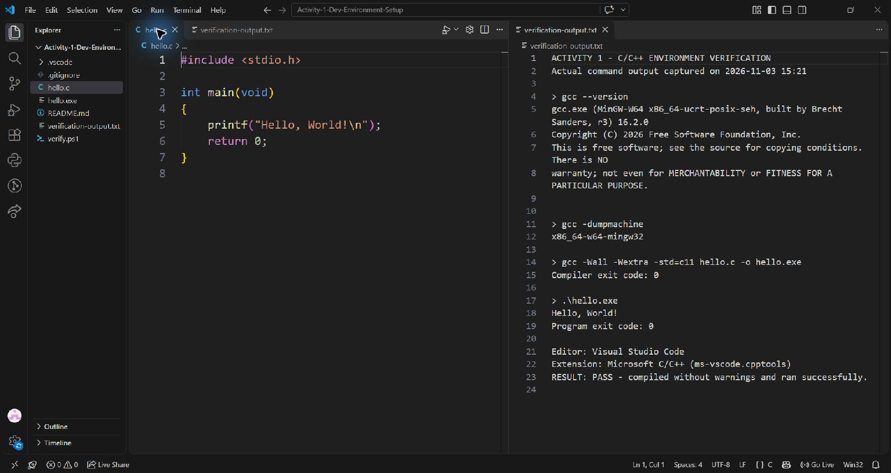

# Activity 1 - Development Environment Setup

VS Code and the Microsoft C/C++ extension (ms-vscode.cpptools) were already installed.
The existing GCC 6.3.0 used the old 32-bit MinGW target, so a portable MinGW-w64 toolchain was added.
The compiler was extracted into the workspace, and VS Code was configured to use its mingw64/bin/gcc.exe.
The project terminal PATH was configured to prefer this compiler over the older C:\MinGW\bin installation.
Running gcc --version confirmed GCC 16.2.0, and gcc -dumpmachine confirmed x86_64-w64-mingw32.
hello.c compiled using gcc -Wall -Wextra -std=c11 hello.c -o hello.exe with exit code 0 and no warnings.
Running .\hello.exe printed Hello, World! and returned exit code 0; verification-output.txt contains the captured results.

## Files

- `hello.c`: source program.
- `verification-output.txt`: actual compiler and program output.
- `setup-screenshot.jpg`: VS Code screenshot showing the source and captured verification output.
- `verify.ps1`: reruns the checks; use `./verify.ps1 -Compiler <path-to-gcc.exe>` if GCC is not on PATH.
- `.vscode/`: portable editor and build-task settings; install MinGW-w64 and put its bin folder on PATH before building.

The portable toolchain is stored outside this submission folder in `work/toolchain/mingw64`.
Compiler distribution: https://winlibs.com/ (MinGW-w64 downloads: https://www.mingw-w64.org/downloads/).

